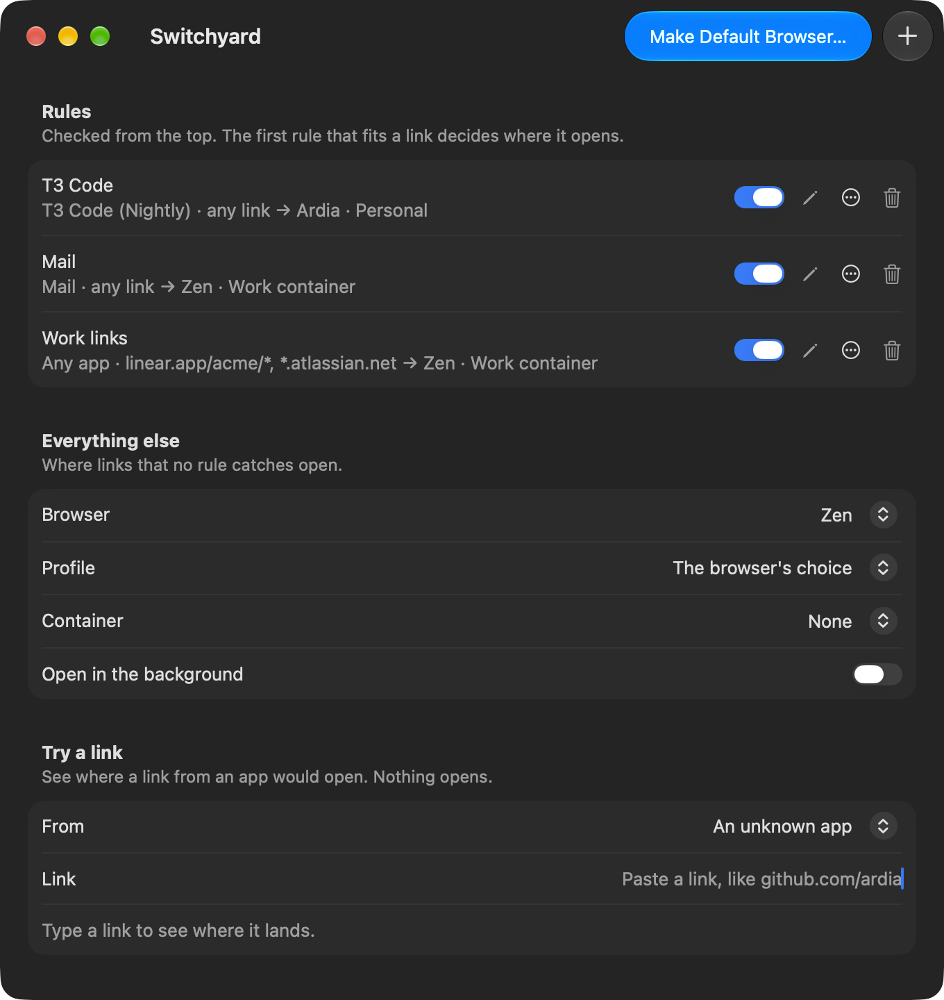

<p align="center">
  
</p>

<h1 align="center">Switchyard</h1>

<p align="center">
  <strong>Every link opens in the right browser and profile.</strong>
</p>

<p align="center">
  
</p>

Switchyard is a link router for macOS. Make it your default browser, and each link from another app opens in the browser, profile or Firefox container you chose for that app or that link. For example, T3 Code links go to Ardia's Personal profile and Mail links go to Zen's Work container. It's a native menu bar app that idles at 13 MB and hands a link to its browser in 22 to 30 ms.

> [!NOTE]
> Switchyard is experimental and needs macOS 26 or later. An Omarchy (Linux) app sharing the same config is planned.

## Install

Download the disk image from the [latest release](https://github.com/donnes/switchyard/releases/latest), open it and drag Switchyard to Applications. Releases are signed and notarized, for Apple silicon Macs.

## Build and run

Building needs Xcode 26 or newer selected with `xcode-select`, because `actool` compiles the icon.

```sh
cd apps/macos
swift test                   # core tests
scripts/build-app.sh         # builds and registers build/Switchyard.app
```

To use your build, copy `build/Switchyard.app` to `/Applications` and open it. macOS remembers the default browser and the login item by the app's location, so a copy that a rebuild replaces can leave stale entries.

From the menu bar icon, pick "Make Switchyard the Default Browser…" (macOS asks you to confirm) and turn on "Open at Login", so the first link after a restart doesn't wait for Switchyard to start. Opening the app again from Finder, Spotlight or Raycast shows its settings.

## Configure

Rules live in `~/.config/switchyard/config.json`. Edit them in settings or by hand; the file reloads as soon as it changes. Rules are checked from the top, and the first one that fits the link's app and URL decides. Try a link in settings shows where a link would go without opening it.

```json
{
  "fallback": { "browser": "app.zen-browser.zen" },
  "rules": [
    { "from": ["com.t3tools.t3code"], "open": { "browser": "com.ardia.browser", "profile": "Personal" } },
    { "match": ["linear.app/acme/*"], "open": { "browser": "app.zen-browser.zen", "container": "Work" } }
  ]
}
```

[docs/config.md](docs/config.md) describes every field and pattern.

| Browser | How Switchyard picks the profile |
|---|---|
| Chrome, Brave, Edge, Vivaldi, Chromium, Helium | `--profile-directory`, from the browser's `Local State` |
| Firefox, Zen | `-P <profile>`, or a container through the [Open external links in a container](https://addons.mozilla.org/firefox/addon/open-url-in-container/) extension |
| Ardia | Its control socket. Turn on "Let the ardia command control Ardia" in Ardia's settings. |
| Safari and others | The link opens in the app, without a profile |

If a profile, a container or Ardia's socket isn't available, the link still opens in the right browser without it, and the menu bar icon shows a warning.

## Compared with Finicky

Switchyard has Finicky's routing by URL pattern and by source app, Chromium and Firefox profiles, background opening and a live-reloading config. It adds Ardia profiles, Firefox containers, a settings window and Try a link. It doesn't have URL rewrites, non-browser app handlers, window-title matching, short URL expansion, browser extensions or JavaScript rules yet.

## Develop

See [AGENTS.md](AGENTS.md) for how we work. The app icon's source and export script are described in [assets/README.md](assets/README.md).

Switchyard is MIT licensed; see [LICENSE](LICENSE).
